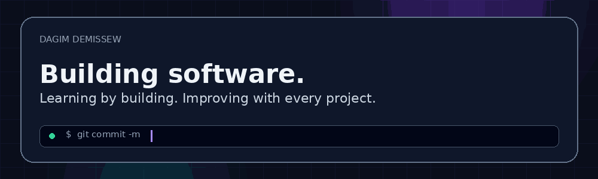
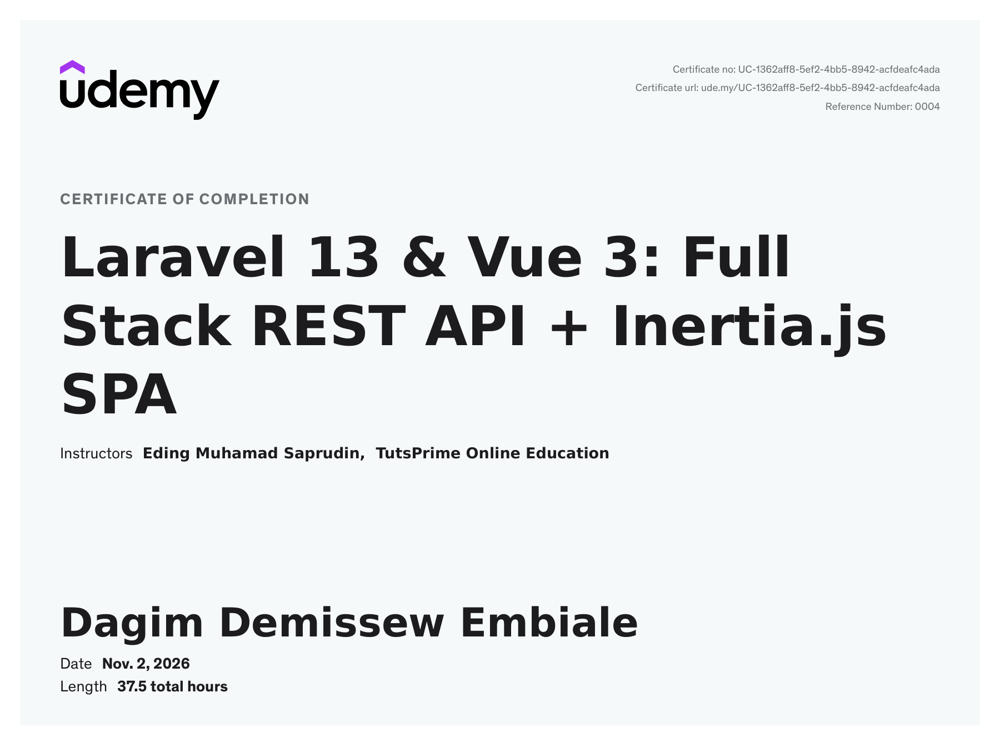
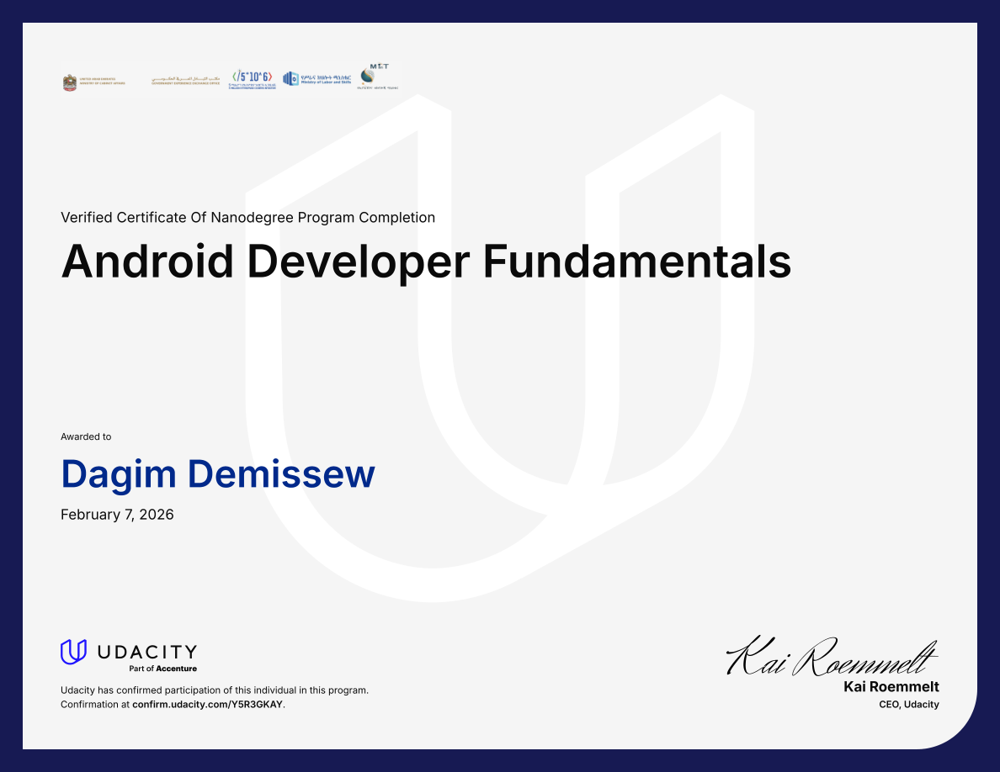
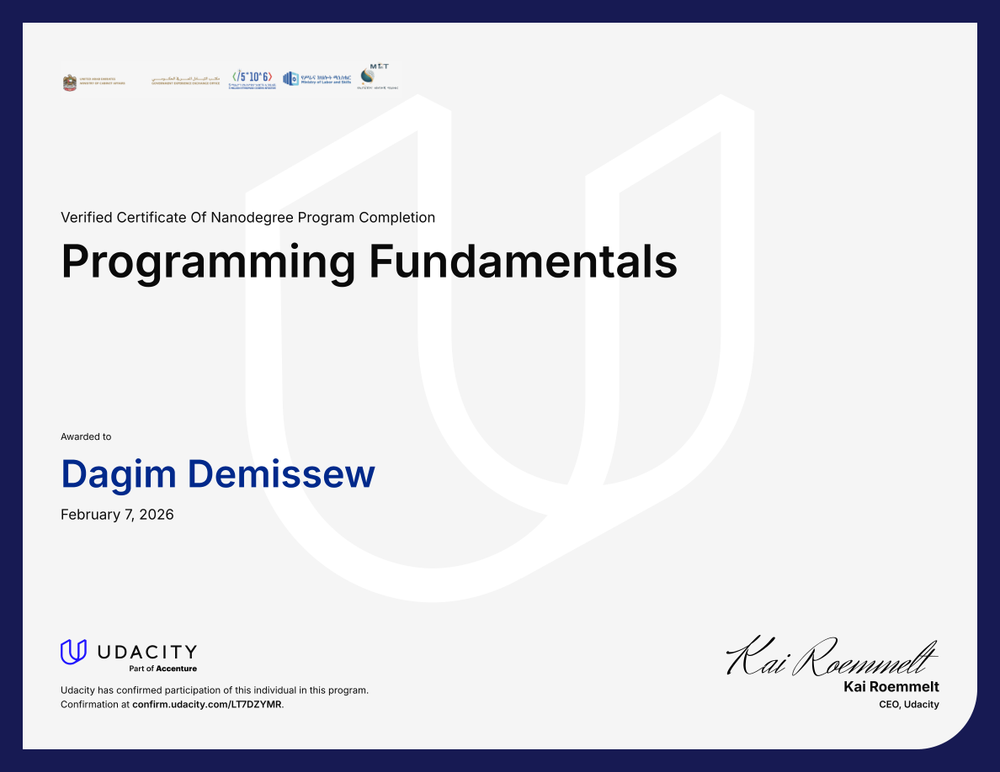
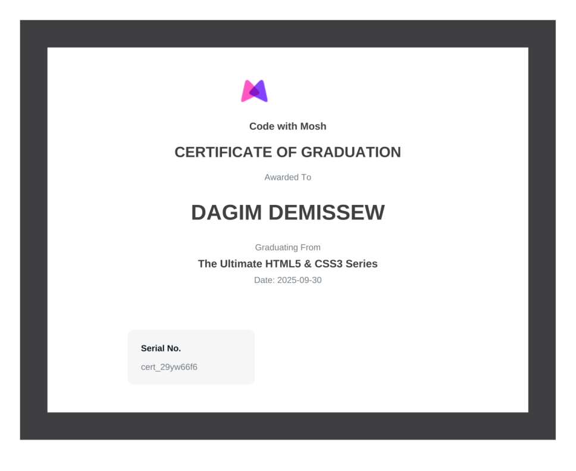
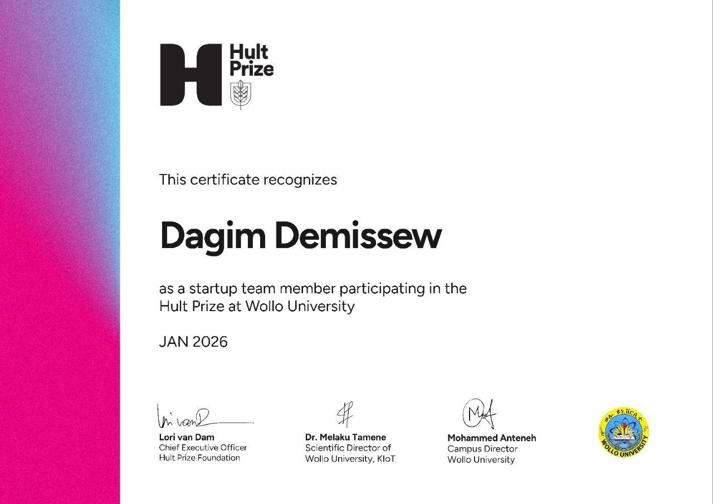
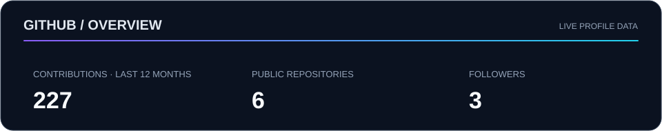
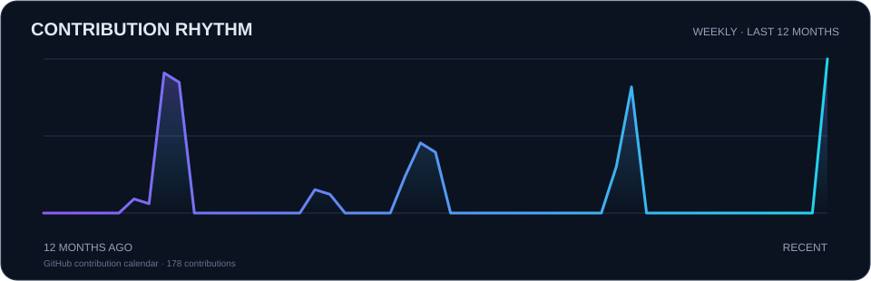

 

## `whoami`

I'm a Software Engineering student at Wollo University, Ethiopia, with a strong interest in building software and figuring out how things work behind the scenes.

I enjoy taking ideas and turning them into working applications. Most of my work has been around full-stack development.

I'm always looking for opportunities to learn something new, take on challenging projects, and become a better developer through hands-on experience.

## What I work with

## Selected work

These are repositories on my GitHub. Open each one for its current README, implementation and source code.

| Project | Repository |
|---|---|
| GeniusGuide WEB | [GeniusGuide-WEB](https://github.com/Dagi-D-Flash/GeniusGuide-WEB) |
| Face Detection App | [Face-Detection-App](https://github.com/Dagi-D-Flash/Face-Detection-App) |
| Smart Study Assistant | [smart-study-assistant](https://github.com/Dagi-D-Flash/smart-study-assistant) |
| Student Grade Management System | [student-grade-management-system](https://github.com/Dagi-D-Flash/student-grade-management-system) |

## Credentials & learning

A selection of courses and participation certificates. Select a preview to open the original certificate file in this repository.

<table>
<tr>
<td width="50%" valign="top">

**Laravel 13 & Vue 3 — Full Stack REST API + Inertia.js SPA**

TutsPrime Online Education · 37.5 hours · Nov 2, 2026

[View original PDF](assets/certificates/laravel-vue-full-stack.pdf)

</td>
<td width="50%" valign="top">

**Android Developer Fundamentals**

Udacity · Feb 7, 2026

[View original PDF](assets/certificates/android-developer-fundamentals.pdf)

</td>
</tr>
<tr>
<td width="50%" valign="top">

**Programming Fundamentals**

Udacity · Feb 7, 2026

[View original PDF](assets/certificates/programming-fundamentals.pdf)

</td>
<td width="50%" valign="top">

**The Ultimate HTML5 & CSS3 Series**

Code with Mosh · Sep 30, 2025

[View original image](assets/certificates/html5-css3-mosh-original.png)

</td>
</tr>
<tr>
<td colspan="2" valign="top">

**Hult Prize — Wollo University**

Startup team member · Jan 2026

</td>
</tr>
</table>

## GitHub activity

---

*Learning by building. Improving one project at a time.*

